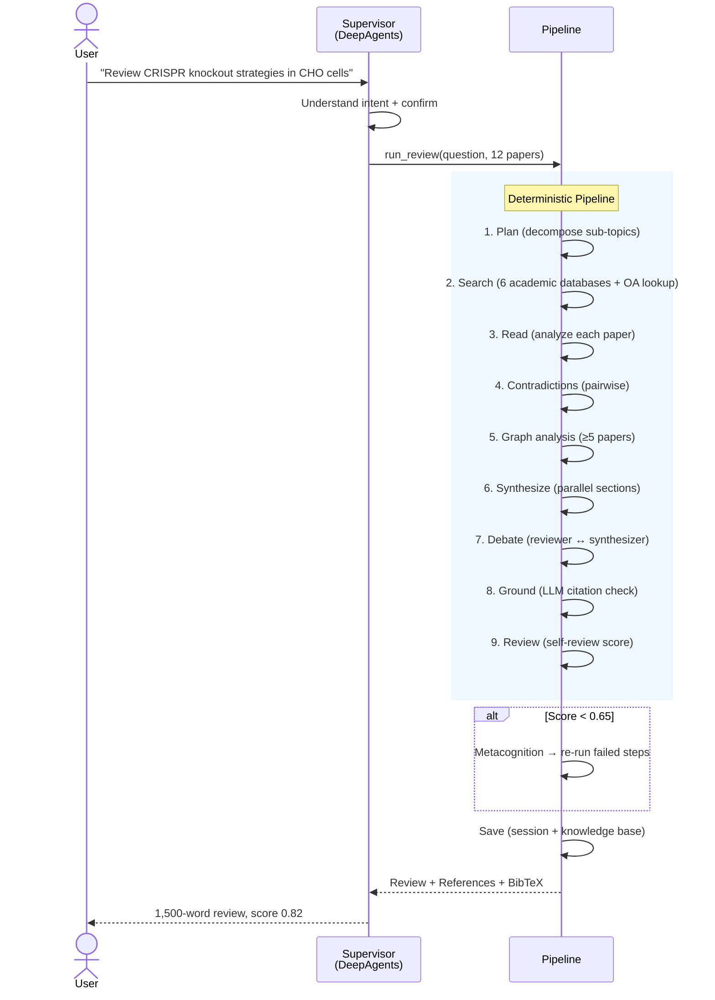
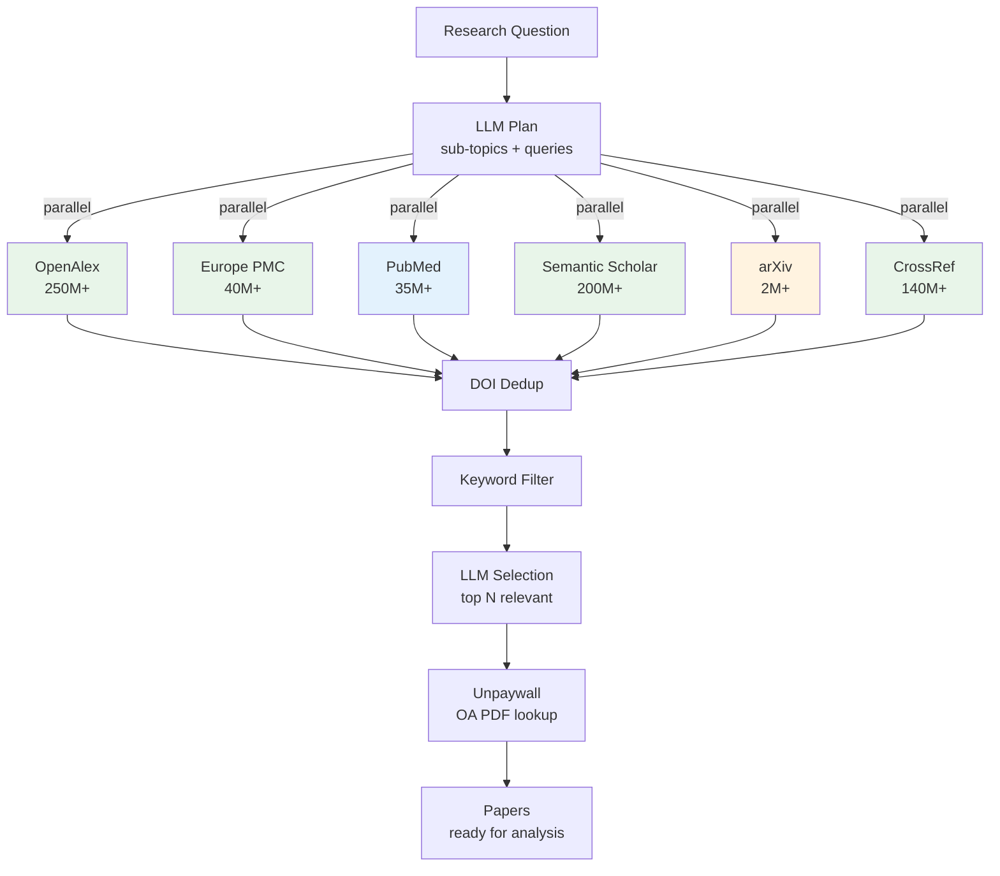

## Now: Cui (June 2026 – present)

Fluent LLM reviews mostly summarise and agree with the user, so Cui supports the researcher's judgment instead of generating documents: question workspace → user-written claims → immutable review rounds in which an LLM challenges the claims → evidence marked supports / contradicts / silent / cannot-assess → human adjudication → landscape / gap view → related-work draft. Event-sourced (FastAPI, Postgres, React / TypeScript). Early development.

## LitScribe v4 (January – June 2026)

LitScribe is an AI literature review engine that takes a research question and returns a 1,500–2,000 word review with LLM-checked citations, methodology comparison, research timeline, and BibTeX export — typically in about two minutes. Each `[@key]` citation is checked by an LLM against the source paper, and the system detects contradictions across papers and presents them as critical analysis.

## Design Choices

1. **Contradiction-aware synthesis** — contradictions detected across papers are injected into the narrative and presented as critical analysis.
2. **Metacognitive quality loop** — after self-review, the system evaluates *which* pipeline steps failed and autonomously re-runs them with adjusted strategy. Strategy decisions are persisted to a knowledge base for future reviews.
3. **Search-augmented refinement** — when users say "add a section about X", LitScribe searches for new papers on X first, analyzes them, then writes the section with citations from the newly found papers.

## Architecture

### DeepAgents Supervisor + Deterministic Pipeline

A natural-language supervisor (built on DeepAgents, 7 tools) interprets user intent, then dispatches a deterministic multi-stage pipeline with a metacognitive quality loop:



Each numbered step persists to a SQLite knowledge base, so reviews can resume after interruption and downstream steps reuse upstream results across sessions.

### Six-Source Academic Search

The Search step (step 2 in the pipeline) fans out across six databases in parallel, then funnels results through dedup → keyword filter → LLM selection → open-access PDF lookup:



| Source | Coverage | Domain |
|--------|----------|--------|
| OpenAlex | 250M+ | All |
| Semantic Scholar | 200M+ | All |
| CrossRef | 140M+ | All (incl. Chinese) |
| Europe PMC | 40M+ | Life science |
| PubMed | 35M+ | Biomedical |
| arXiv | 2M+ | CS/Physics/Math |

Domain-aware routing auto-skips arXiv for biology/medicine; LLM-based selection filters irrelevant results after DOI deduplication.

## Features

### Citation Grounding
Every `[@key]` is checked by an LLM against the source paper; claims it judges unsupported are flagged and rewritten. LLM-checked citation-support rate: **62–100%** across five benchmark queries.

### Contradiction Detection
Pairwise comparison surfaces opposing findings, which are then injected into the review as critical commentary:

> `[@cho2025]`: "FUT8 knockout had no negative effect on cell growth"
> `[@lin2020]`: "FUT8 knockout reduced cell viability by 40%"
> → classified as `opposing_conclusions` (major) → integrated into discussion

### Multi-Agent Debate
After synthesis, a reviewer agent critiques the draft → synthesizer revises → up to 2 rounds. Catches unsupported claims, missing perspectives, and weak synthesis.

### Local Paper Modes
- `litscribe draft my_review.md paper1.pdf paper2.pdf` — analyze your draft against references
- `litscribe outline *.pdf refs.bib` — "what review could I write from these?"
- `litscribe augment "CRISPR delivery" papers/*.pdf` — your papers + online search

### Natural Language Interface
The supervisor understands intent in English or Chinese and routes to the right tool:

```
"写个关于transformer的综述，3个主题"     → run_review (Chinese)
"加一段关于delivery methods"             → refine_review (searches new papers first)
"这篇综述适合什么人看"                   → assess_reading_level
```

### Cross-Lingual
Direct generation in target language (not post-translation), CJK-aware word counting, mismatch detection.

### Security
HMAC integrity on the knowledge base to detect data poisoning, prompt injection filter, XSS prevention, rate limiting, PDF URL domain whitelist, parameterized SQL.

## Review Output

Every generated review includes:

- Thematic analysis with `[@key]` Pandoc citations
- BibTeX-compatible reference list
- **Methodology Comparison** table across all papers
- **Research Timeline** (foundation → development → frontier)
- **Statistical Summary** — extracted p-values, effect sizes, sample sizes
- **Suggested Figures** — recommended visualizations with placement notes

## Interfaces

- **CLI** — 12 commands (`chat`, `review`, `draft`, `outline`, `augment`, `sessions`, `export`, `evaluate`, `serve`, `skills`, …)
- **Web UI + REST API** — ~20 endpoints including SSE streaming for the review pipeline
- **Sessions + Knowledge Base** — persistent across reviews; supports diff-based refinement

## Benchmark

| Domain | Score | Papers | Words | Citation support | Time |
|--------|-------|--------|-------|-----------|------|
| Biology (CHO CRISPR) | **0.82** | 9 | 1,649 | 83% | 106 s |
| CS (LLM reasoning) | 0.72 | 12 | 1,535 | 63% | 121 s |
| Medicine (scRNA-seq TME) | 0.65 | 12 | 1,709 | 68% | 115 s |
| CS (transformer attention) | 0.55 | 12 | 1,643 | 62% | 153 s |
| Chemistry (sesquiterpene) | 0.55 | 3 | 1,338 | 100% | 103 s |

*LLM self-review score 0–1, one run per query (about ±0.10 between runs); citation support = % of citations an LLM judged supported by the source paper, not accuracy against human labels. Model: DeepSeek V4 Flash.*

## Technical Stack

| Component | Technology |
|-----------|------------|
| Language | Python 3.12+ |
| Supervisor | DeepAgents (7 tools) |
| LLM | OpenAI-compatible API (DeepSeek by default); Anthropic / Ollama optional |
| Knowledge Graph | NetworkX + Leiden community detection |
| Embeddings | sentence-transformers |
| PDF Processing | pymupdf4llm |
| Storage | SQLite (sessions, knowledge base with HMAC, vectors) |
| Backend | FastAPI + SSE streaming |
| Codebase | ~12.5K lines Python + ~4.3K TypeScript, 49 unit tests (v4.0.0) |

## Limitations & Roadmap

- Requires API keys for cloud LLM functionality
- PDF extraction quality varies with document formatting
- LLM-checked citation-support rate is lower in some CS / medicine queries (62–68%)
- The 49 unit tests do not cover the core pipeline, grounding, debate or search

LitScribe is frozen at v4.0.0; development continues as Cui.

## GitHub Repositories

[Cui](https://github.com/arnold117/Cui) · [LitScribe](https://github.com/arnold117/LitScribe) (v4, frozen)

## Timeline

**LitScribe**: January – June 2026 (frozen at v4.0.0)  
**Cui**: June 2026 – present (early development)
